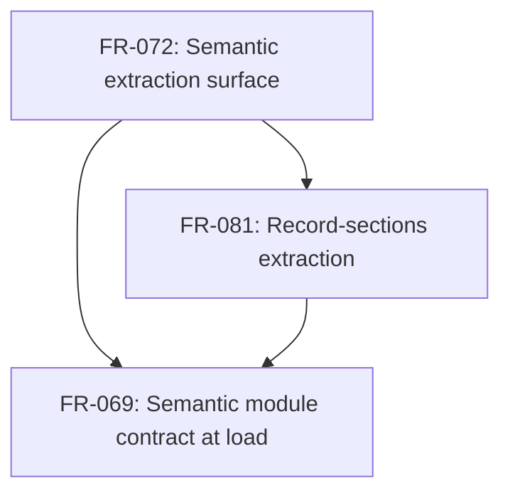

## Summary

Reviewed the new `requires` edges and the FR-069/FR-081 cross-reference for prerequisite ordering. FR-069 now explicitly requires FR-072's semantic envelope and FR-081's section extraction before composing the declaration record; no cycle is introduced, and frontmatter projection remains an FR-069 responsibility.

## Classification

| Requirement | Class | Rationale |
| --- | --- | --- |
| FR-072 | Enablement | Defines the nested `SemanticExtraction.record` and `semantic-v1` envelope that the composition extends. |
| FR-081 | Enablement | Defines body-derived record-section values that FR-069 composes into the declaration record. |
| FR-069 | Feature | Adds authored frontmatter projection and `data_schema` validation to registry-backed semantic extraction. |

## Dependency Graph

## Topological Order

1. FR-072 establishes the envelope and declaration record.
2. FR-081 establishes section-derived record values.
3. FR-069 composes those values with authored frontmatter and validates the resulting declaration record.

## Cycles

None detected in the declared prerequisite graph. The prose cross-reference from FR-081 to FR-069 documents the separate projection and does not define a reciprocal prerequisite edge.

## Findings

| ID | Severity | Summary | Refs |
| --- | --- | --- | --- |
| FND-001 | low | No findings (placeholder) | - |
