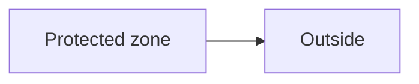

# [BOUND-MISSING-LEVEL] BoundaryWithoutTrustLevel

## Boundary



## Properties

| Field | Type | Multiplicity | Constraints |
|---|---|---|---|
| boundary_id | UUID | 1..1 | identity |
| trust_level | String | 1..1 | minLength: 1 |

## Invariants

Every crossing is addressed.

### EveryCrossingAddressed

```ocl
context BoundaryWithoutTrustLevel
inv EveryCrossingAddressed:
  self.boundary_id <> ''
```
