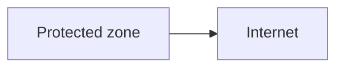

# [BOUND-INTERNET] InternetBoundary

## Boundary



## Properties

| Field | Type | Multiplicity | Constraints |
|---|---|---|---|
| boundary_id | UUID | 1..1 | identity |
| trust_level | String | 1..1 | minLength: 1 |

## Invariants

Every crossing leaves the protected zone.

### LeavesProtectedZone

```ocl
context InternetBoundary
inv LeavesProtectedZone:
  self.boundary_id <> ''
```
